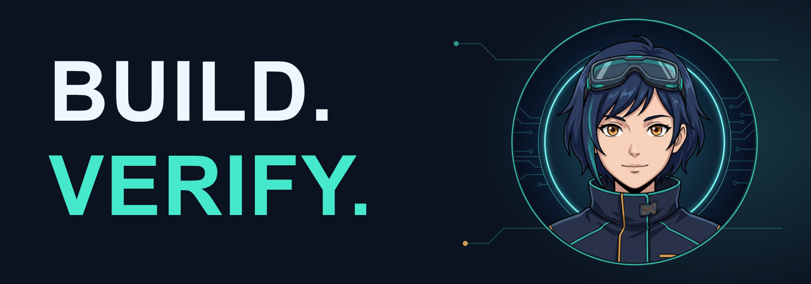

  

<h1 align="center">Aki Forge</h1>

<strong>ACCI · AI-assisted cloud development</strong>

Open tools. Verified builds. Portable handoffs.

  <a href="https://github.com/kyoroshyvtuber-lgtm/acci-toolkit">ACCI toolkit</a> ·
  <a href="https://github.com/kyoroshyvtuber-lgtm/acci-toolkit/blob/main/docs/START_HERE.ru.md">Start here</a> ·
  <a href="https://github.com/kyoroshyvtuber-lgtm/acci-toolkit/actions/workflows/ci.yml">Builds</a>

---

## Building ACCI

A provider-independent toolkit for an agent-assisted development loop:
**plan → inspect → code → test → build → verify → hand off.**

- **Python tooling** — project workspaces, safe ZIP intake, command logs and task checkpoints.
- **Cloud builds** — GitHub Actions templates, Android debug APKs and unsigned iOS simulator builds.
- **Portable context** — `AGENTS.md` and reviewed handoffs, without a required Notion account or model-provider API.

[Explore the MIT-licensed toolkit →](https://github.com/kyoroshyvtuber-lgtm/acci-toolkit)

## Engineering principles

- Small changes, separate branches and pull requests.
- Read the logs; verify the artifacts, not just a green badge.
- Keep credentials out of source and handoffs.
- Make it possible for the next agent to continue from the repository.

---

Aki Forge is an original anime engineering mascot for the ACCI project.
